## Introdução

Recentemente, me inspirei na série de vídeos [**How to Make a Roguelite Game**](https://www.youtube.com/playlist?list=PLSHqi2dTiNGCncSOksACfJChpfPa6qz9w) e resolvi transformá-la em um laboratório para estudar diferentes arquiteturas de código: **Spaghetti**, **ECS (Entity-Component-System)** e **SOAP (Scriptable Object Architecture Pattern)**.

A proposta é experimentar, na prática, como cada abordagem lida com aspectos fundamentais do desenvolvimento de jogos, como **organização**, **escalabilidade** e **manutenção**.

Neste primeiro capítulo da série, mergulhei na forma mais rápida — e perigosa — de começar: a temida **Arquitetura Spaghetti**.

Repositório no [Github.](https://github.com/solracjunio/ROG/tree/spaghetti)

---

## Parte 1 – O Começo do Espaguete

**⏱ Tempo de desenvolvimento:** 0 a 53 minutos
**🎥 Vídeo base:** [Part 1: ScriptableVariables and Bindings](https://www.youtube.com/watch?v=Yfp9aUxkfw4&index=1)

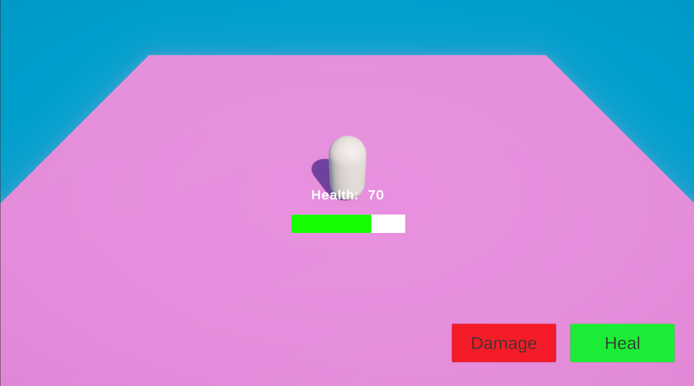

Logo de cara, temos uma classe `Player` com **53 linhas** — e ela faz absolutamente tudo:

* Gerencia o input do jogador
* Controla a vida
* Armazena e atualiza os próprios dados
* Atualiza diretamente a UI: texto e barra de vida

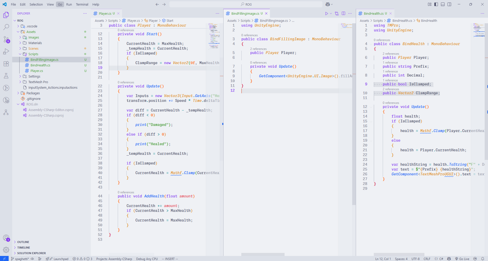

Essa conexão direta entre lógica e interface é um dos primeiros sinais do espaguete surgindo. A classe `Player` não apenas executa suas funções, mas também comanda elementos visuais, o que a torna **fortemente acoplada** a partes que deveriam estar separadas.

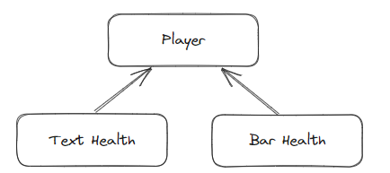

### ✅ Pontos positivos:

* **Extremamente rápido de começar**
* **Implementação direta, sem muita abstração**

### ❌ Pontos negativos:

* Classe `Player` inflada desde o início
* Lógica e UI misturadas
* Baixa modularidade, dificultando manutenção e testes

---

## Parte 2 – Crescimento Caótico

**⏱ Tempo de desenvolvimento:** 53 minutos a 1h39
**🎥 Vídeo base:** [Part 2: Scriptable Events, Variables and Bindings](https://www.youtube.com/watch?v=Xl5l3HqoQAk&index=2)

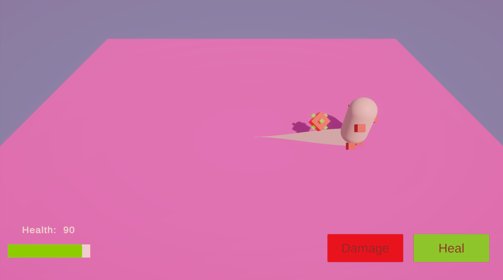

Adicionamos partículas, vinhetas e outras reações visuais. Resultado? A classe `Player` agora possui **79 linhas**, absorvendo mais responsabilidades do que nunca.

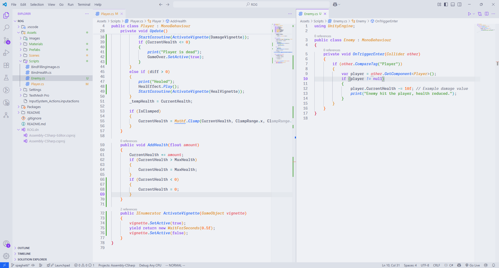

O número de dependências visíveis e invisíveis cresce. A `Player` está ligada a **cinco elementos de UI**, e **dois dependendo diretamente dela**. Isso é o início de uma **teia de dependências**.

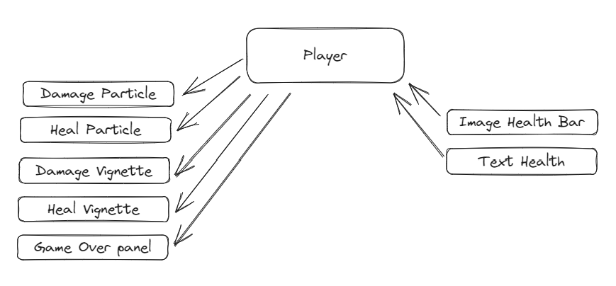

### Conclusão da Parte 2

O sistema ainda é funcional, mas já sentimos o custo. O código começa a perder legibilidade e modularidade. A classe `Player` evolui para um clássico **"God Object"**.

---

## Parte 3 – A Teia de Dependências

**⏱ Tempo de desenvolvimento:** 1h39 a 2h32
**🎥 Vídeo base:** [Part 3: Scriptable Lists](https://www.youtube.com/watch?v=ARyVWje6Nlk&index=3)

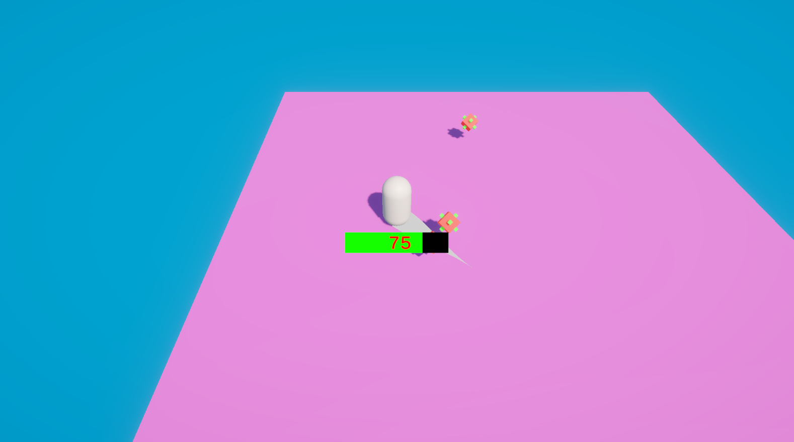

Agora adicionamos um sistema de *Spawner* de inimigos, com efeitos visuais e interações mais complexas.

O curioso? A classe `Player` quase não mudou. Mas o número de **relações cruzadas entre sistemas explodiu**.

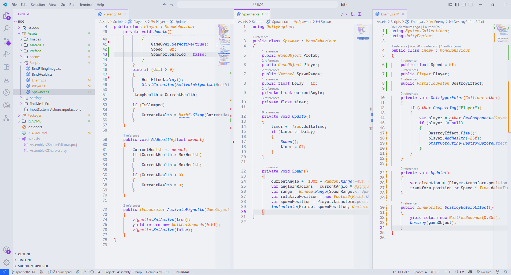

*Player* e *Spawner* passaram a depender mutuamente, formando **relações cíclicas** que violam princípios básicos de arquitetura.

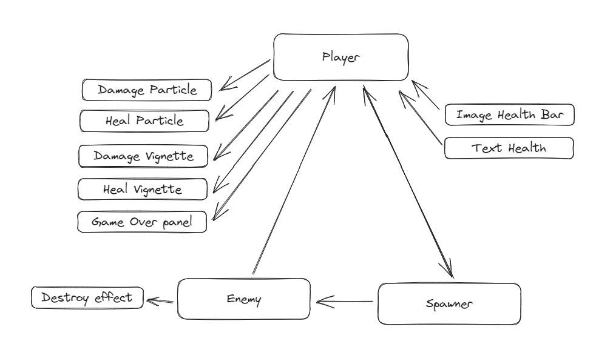

### Conclusão da Parte 3

O acoplamento atingiu um novo nível. Cada novo recurso exige alterações em partes já existentes, o que dificulta testes e impede crescimento sustentável. O projeto se comporta como um prato de espaguete: **tudo está grudado em tudo**.

---

## Parte 4 – O Início do Cansaço

**⏱ Tempo de desenvolvimento:** 2h32 a 4h08
**🎥 Vídeo base:** [Part 4: Weapon and Pickups](https://www.youtube.com/watch?v=qvbSTnvsOtg&index=4)

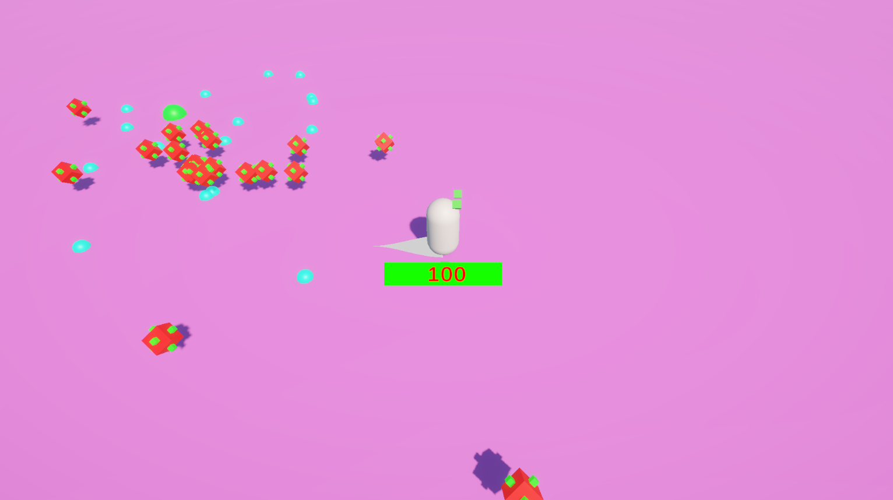

Nessa etapa, o desgaste começa a aparecer. Implementar novas funcionalidades já não é tão rápido. O código está inflado, confuso e exige cada vez mais cuidado para não quebrar o que já existe.

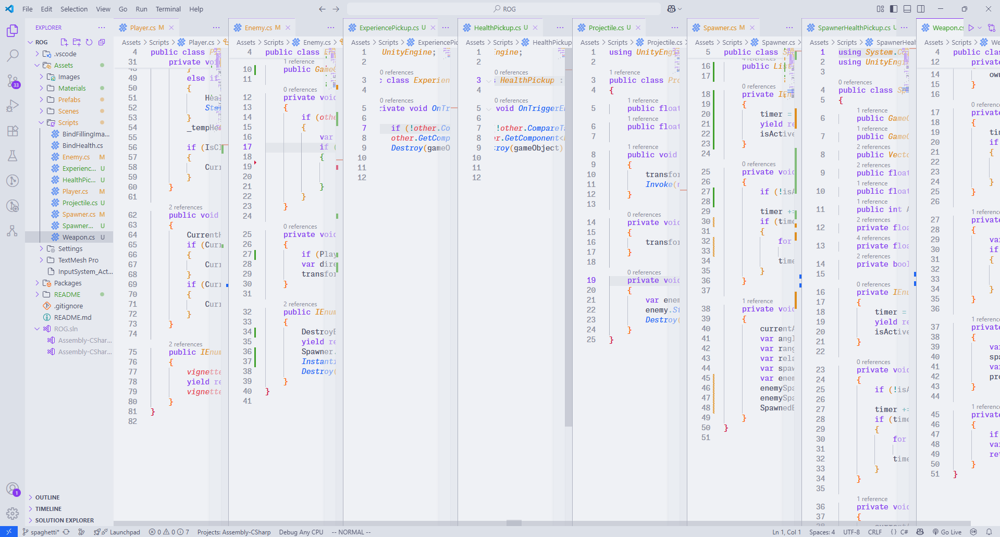

A quantidade de scripts aumentou, mas não de forma organizada. Os papéis das classes se misturam. Alterar algo exige navegar entre vários arquivos e lembrar de conexões não explícitas.

Exemplos problemáticos:

* O `Enemy` passou a conhecer diretamente o prefab de **Experience Pickup** — violando a separação de responsabilidades.
* Começamos a ver **códigos duplicados com pequenas variações**, uma das consequências da falta de modularidade.

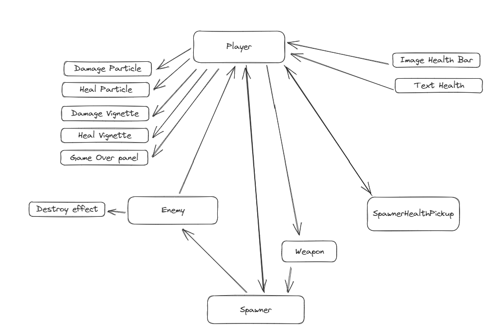

### Conclusão da Parte 4

Neste ponto, o projeto já demonstra claros sinais de exaustão estrutural. A produtividade diminui. A motivação também. O código começa a trabalhar contra você.

---

## Parte 5 – Final: Quando o Código Pesa

**⏱ Tempo de desenvolvimento:** 4h08 a 5h36
**🎥 Vídeo base:** [Part 5: Abilities](https://www.youtube.com/watch?v=6KjGywXC464&list=PLSHqi2dTiNGCncSOksACfJChpfPa6qz9w&index=7)

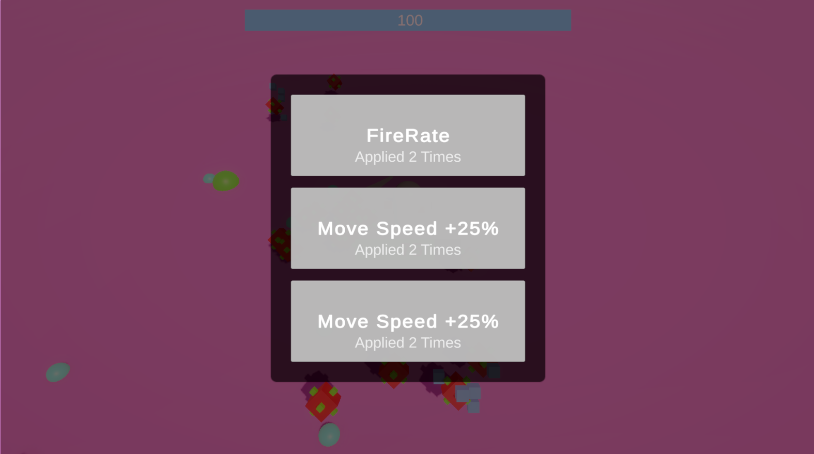

Adicionamos o sistema de **habilidades**, e com ele vieram mais complexidades — mas nenhuma surpresa. Os problemas anteriores só se agravaram: mais duplicações, mais dependências cruzadas, menos clareza.

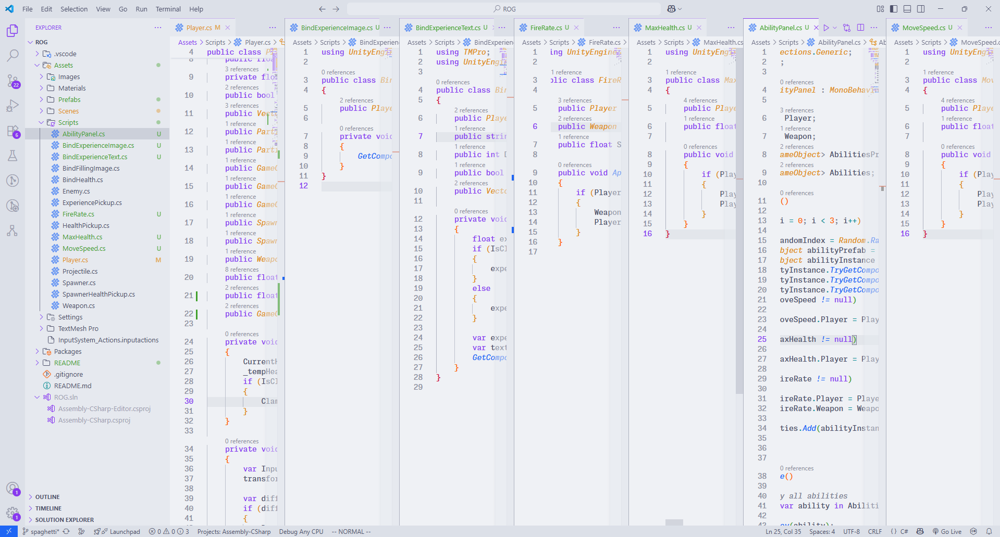

O VSCode virou um campo minado. As classes cresceram, perderam foco e as responsabilidades estão diluídas.

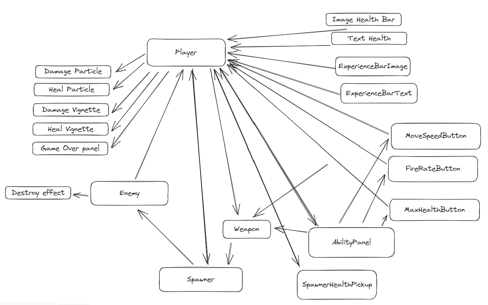

A dependência entre sistemas se tornou uma **malha de fios soltos e conectores improvisados**, exigindo constante vigilância para manter tudo funcionando.

---

## Conclusão Final da Arquitetura Spaghetti

Encerrar essa fase reforça o que já era esperado: a arquitetura *Spaghetti* é útil apenas para os primeiros passos — **rápida para começar, desastrosa para escalar**.

### Principais problemas observados:

* Classes com responsabilidades demais
* Repetição de lógica em vários pontos
* Dependências circulares
* Falta de separação entre lógica e apresentação
* Dificuldade para testar, manter e evoluir

Apesar dos pesares, essa abordagem cumpriu seu papel: **revelar os limites de um código sem estrutura clara**. Servirá como base de comparação para as arquiteturas seguintes.

---

## Próximo passo: ECS

No próximo post, reiniciarei o projeto com **[ECS](https://solracjunio.github.io/2025/07/03/explorando-arquiteturas-ecs.htm)**.

Será uma mudança total de paradigma — com foco em **modularidade, separação de responsabilidades** e **desacoplamento entre os sistemas**.

Se você chegou até aqui, prepare-se para reorganizar o caos. Até a próxima!
