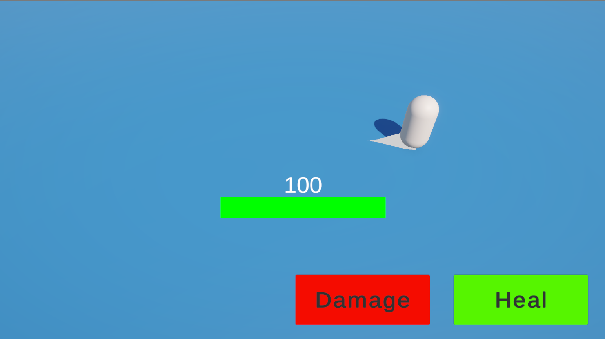
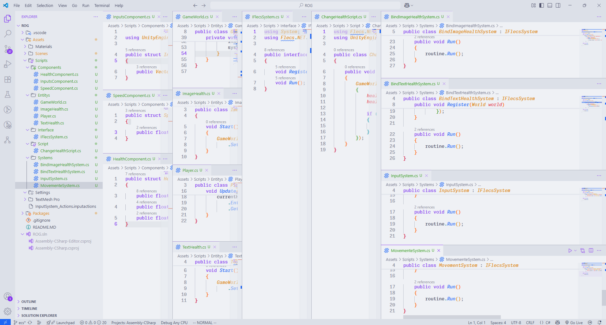
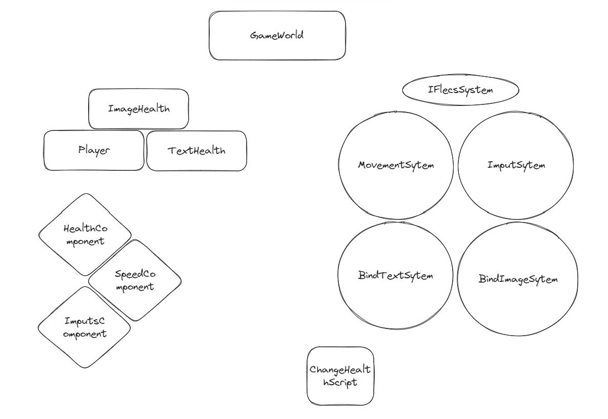
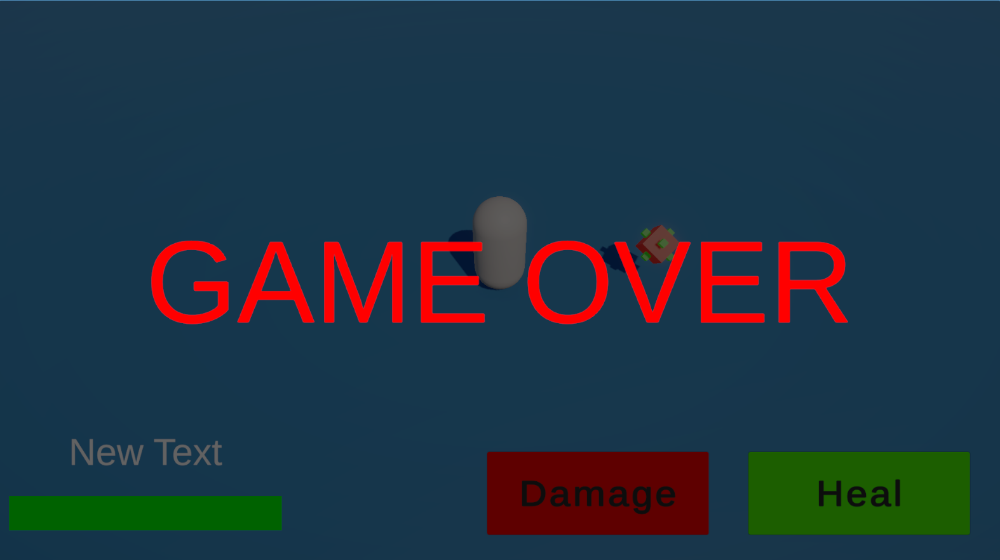
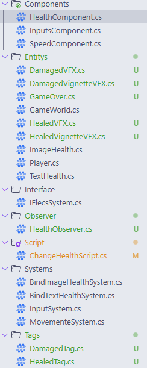

## Introdução

Se você ainda não conferiu o [post anterior sobre a arquitetura Spaghetti](https://solracjunio.github.io/2025/06/30/Explorando-Arquiteturas-Spaghetti.html), recomendo começar por lá para entender o ponto de partida deste experimento.

Neste post, vamos dar os primeiros passos na implementação do projeto utilizando a arquitetura **ECS (Entity-Component-System)**. Diferente da abordagem Spaghetti, que é mais direta porém propensa a acoplamentos indesejados, a ECS busca oferecer uma estrutura **modular, escalável e mais fácil de manter a longo prazo**.

Para isso, utilizei o **Flecs**, uma biblioteca ECS originalmente escrita em C/C++, por ser leve, poderosa e já familiar para mim. Apesar de o suporte oficial ao Unity ter sido descontinuado, existe um [binding para C# compatível com a versão 4.0.2](https://github.com/BeanCheeseBurrito/Flecs.NET/tree/v4.0.2) que funciona muito bem com Unity — e foi o que utilizei neste projeto.

Repositório no [Github.](https://github.com/solracjunio/ROG/tree/ecs)

---

## Parte 1 – Primeiros Passos com ECS

**⏱ Tempo de desenvolvimento:** 0h00 a 2h27  
**🎥 Vídeo base:** [Part 1: ScriptableVariables and Bindings](https://www.youtube.com/watch?v=Yfp9aUxkfw4&index=1)

### Instalando o Flecs no Unity

Para instalar o Flecs.NET no seu projeto Unity, adicione o repositório abaixo via Git URL:

```console
https://github.com/BeanCheeseBurrito/Flecs.NET.Unity.git
````

---

### Relato de Desenvolvimento

Concluí a primeira etapa após cerca de 2h27 de trabalho. Como já fazia algum tempo desde minha última experiência com Flecs, precisei revisitar a documentação — o que aumentou um pouco o tempo de desenvolvimento.



#### Comparativo com a Arquitetura Spaghetti

* 🕒 **Tempo**: Bem superior aos 53 minutos da versão Spaghetti.
* 🔍 **Debug**: Sem integração direta com o Unity Inspector — é necessário desenvolver ferramentas auxiliares.
* 🧠 **Design**: Requer maior planejamento e divisão de responsabilidades, resultando em mais arquivos.



---

## Análise Técnica

### ✅ Pontos Positivos

* **Separação clara de responsabilidades** entre componentes, sistemas e entidades.
* **Arquitetura modular**, facilitando manutenção, testes e evolução do projeto.
* **Organização escalável**, ideal para projetos de médio e grande porte.

### ❌ Pontos Negativos

* **Falta de integração com o editor do Unity**, dificultando ajustes rápidos e inspeção visual.
* **Proliferação de arquivos**, o que pode dificultar a navegação e prototipação.
* **Curva de aprendizado mais alta**, especialmente para quem vem de arquiteturas tradicionais como POO(Programação Orientada a Object) puro.



> ⚠️ Como as dependências entre sistemas são descentralizadas (o que é positivo), optei por não traçar ligações explícitas no diagrama acima — apenas listar os elementos envolvidos.

---

## Conclusão – Parte 1

A estrutura ECS se mostrou promissora em termos de organização e manutenção. No entanto, o **tempo de desenvolvimento aumentou significativamente**, o que **desfavorece seu uso em protótipos rápidos ou projetos curtos**.

Para projetos maiores ou com foco em escalabilidade a longo prazo, ECS pode ser uma excelente escolha. Mas para times pequenos ou desenvolvedores solo, o custo de complexidade só se justifica com uma visão clara de futuro.

---

## Parte 2 – Abandono da Abordagem ECS

**⏱ Tempo de desenvolvimento:** 2h27 a 4h24
**🎥 Vídeo base:** [Part 2: Scriptable Events](https://www.youtube.com/watch?v=Xl5l3HqoQAk&list=PLSHqi2dTiNGCncSOksACfJChpfPa6qz9w&index=2)

Conforme avancei para a segunda parte, ficou evidente que **a abordagem ECS estava se tornando um gargalo**. Enquanto nesta etapa ainda lutava com a base da arquitetura, na versão Spaghetti eu já havia avançado até a parte 4 do vídeo-tutorial.



### Dificuldades Encontradas

* 🔧 **Ausência de integração com o editor** comprometeu seriamente a experiência de debugging e ajustes de valores.
* ⚙️ Tive que **recorrer a scripts fora do paradigma ECS** para implementar certos comportamentos, comprometendo a coesão da arquitetura.
* 📁 **Aumento no número de arquivos** e abstrações trouxe complexidade desnecessária para um projeto de escopo pequeno.



---

## Conclusão – Parte 2

Apesar do potencial da ECS para grandes projetos, **ela se mostrou excessiva para este caso específico**. O esforço necessário para implementar funcionalidades simples — como trocar valores ou interagir entre entidades — não compensou os benefícios esperados.

Para jogos maiores, com equipes organizadas e planejamento de longo prazo, ECS pode fazer toda a diferença. Mas **para projetos indies, experimentais ou solos, soluções mais diretas ainda são mais produtivas e eficientes**.

---

## O Que Vem a Seguir

Nos próximos posts, vou explorar a abordagem **[SOAP (Scriptable Object Architecture Pattern)](https://solracjunio.github.io/2025/07/20/explorando-arquiteturas-soap.html)** — que promete unir a modularidade com uma integração mais amigável ao Unity.

Acompanhe a série para ver como diferentes arquiteturas impactam o desenvolvimento do mesmo jogo!
