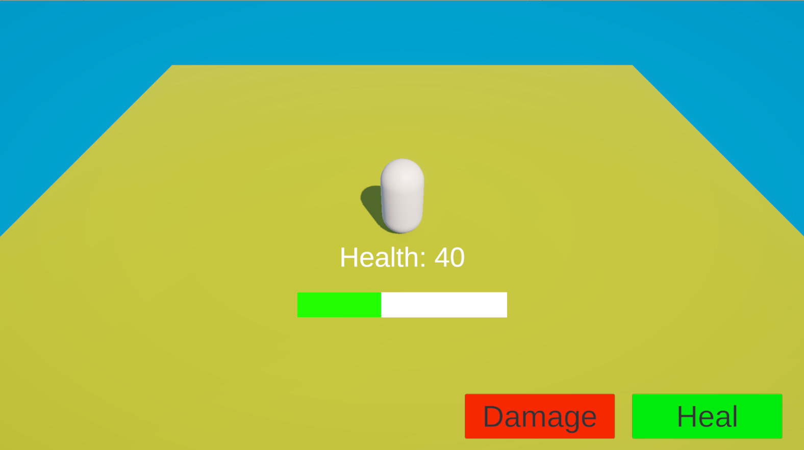
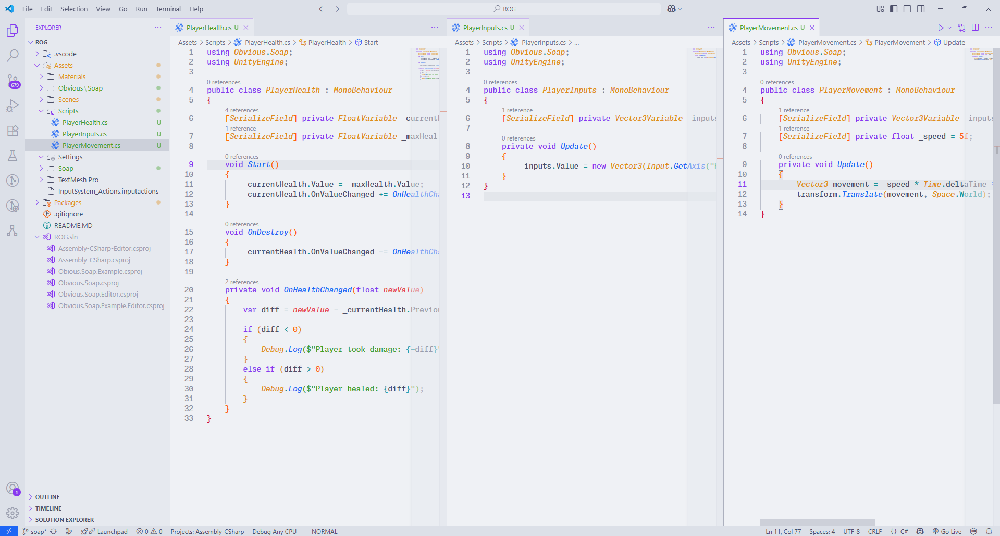
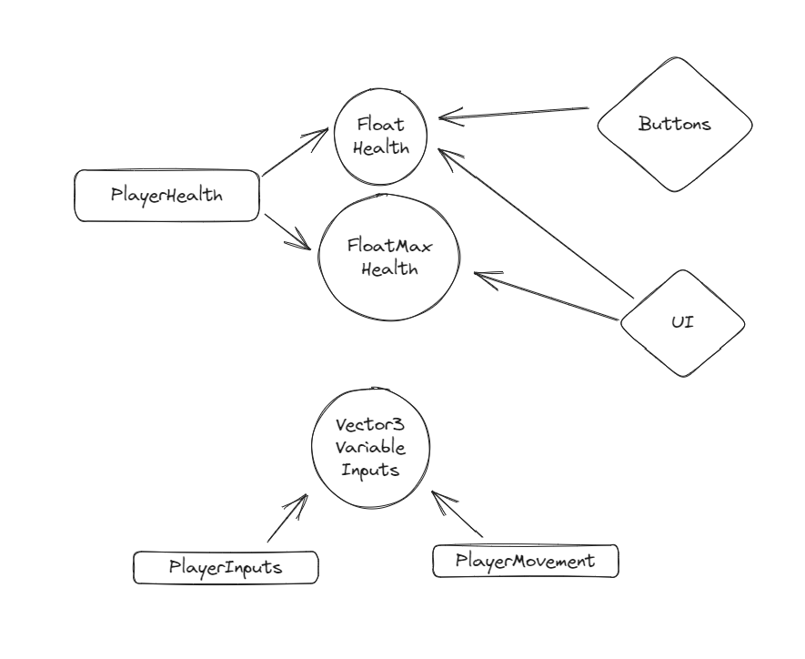
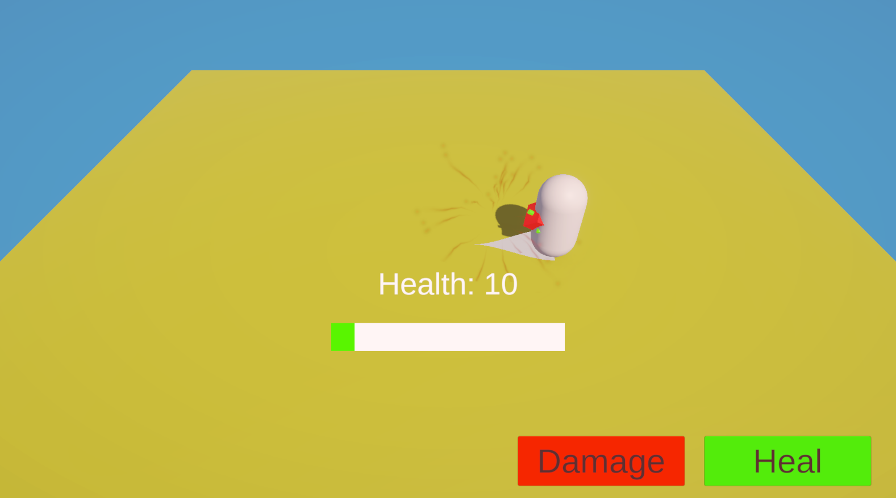
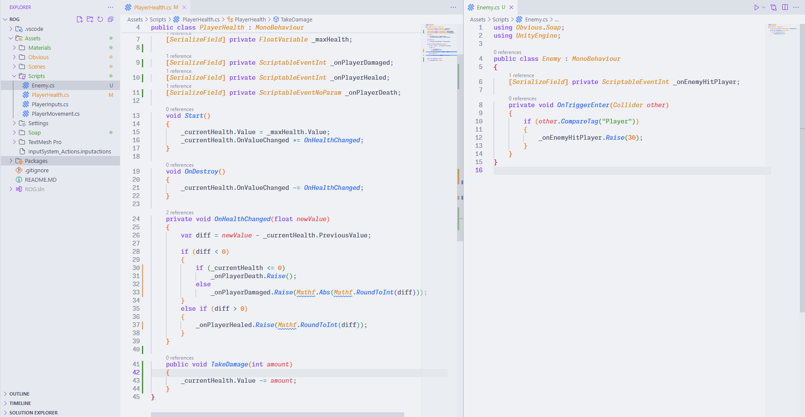
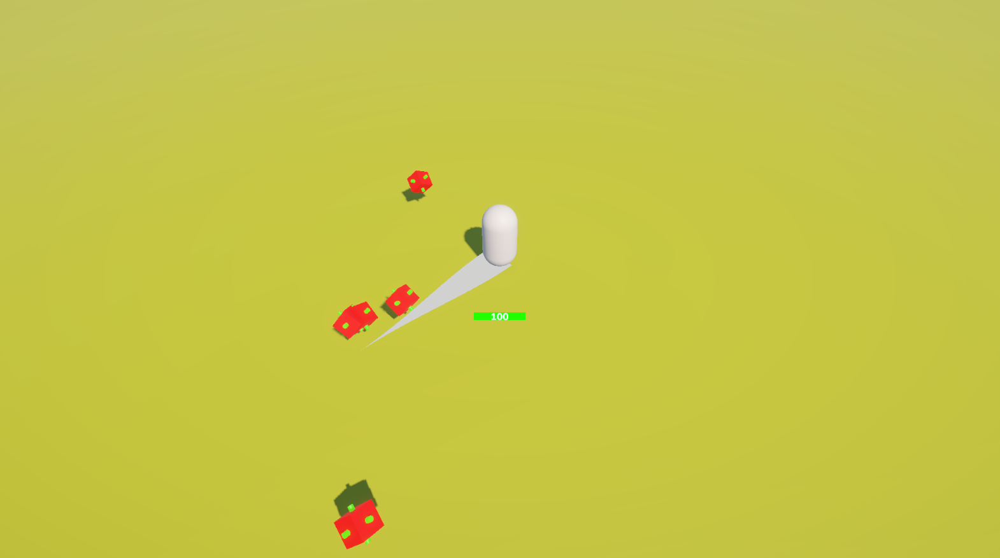
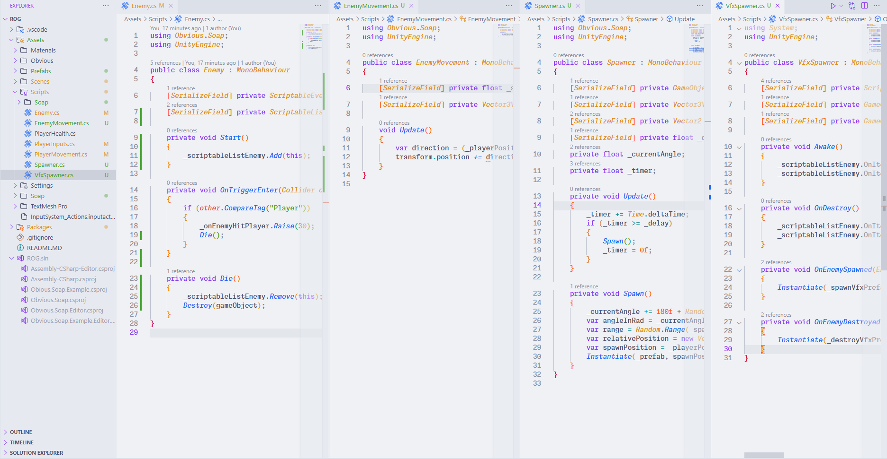
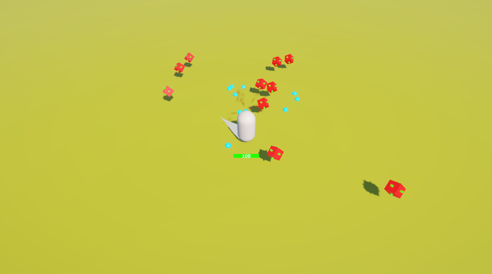
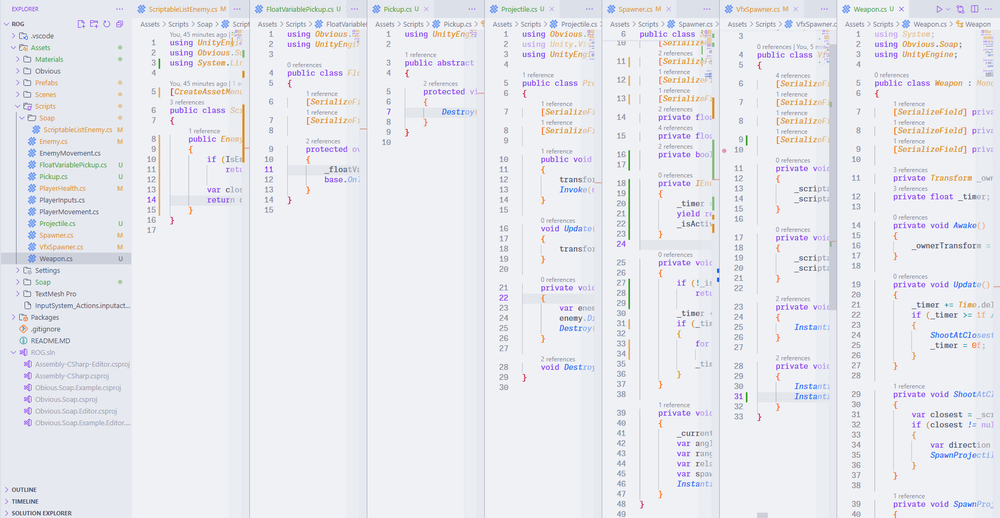

## Introdução

Se você ainda não conferiu o [primeiro post sobre a arquitetura Spaghetti](https://solracjunio.github.io/2025/06/30/Explorando-Arquiteturas-Spaghetti.html), recomendo começar por lá para entender o ponto de partida deste experimento.

No [post anterior](https://solracjunio.github.io/2025/07/03/explorando-arquiteturas-ecs.html), explorei a arquitetura **ECS (Entity-Component-System)**, que trouxe melhorias estruturais em relação à Spaghetti, mas ainda exigia esforço para manter a clareza e a modularidade.

Agora, é hora de explorar a **SOAP (Scriptable Object Architecture Pattern)**, uma abordagem pensada para ser **modular, editável e fácil de debugar**. Para isso, utilizei o framework [**SOAP**](https://obvious-game.gitbook.io/soap), mas o conceito também pode ser aplicado com alternativas gratuitas como [Unity Atoms](https://unity-atoms.github.io/unity-atoms/) ou com uma implementação própria.

O mais importante aqui não é a ferramenta em si, mas os **princípios da arquitetura** demonstrados no vídeo abaixo:



Repositório no [Github.](https://github.com/solracjunio/ROG/tree/soap)

---

## Parte 1 – Primeiros Passos com SOAP

**⏱ Tempo de desenvolvimento:** 0 a 27 minutos  
**🎥 Vídeo base:** [Part 1: Scriptable Variables and Bindings](https://www.youtube.com/watch?v=Yfp9aUxkfw4&index=1)

### Relato de Desenvolvimento

Essa primeira etapa foi concluída em apenas 27 minutos — um tempo bem abaixo do necessário na abordagem Spaghetti. Isso se deve, em parte, ao suporte de um tutorial, mas também à **estrutura clara e guiada** da arquitetura.

### Comparativo com a Arquitetura Spaghetti

- 🕒 **Tempo:** Metade do tempo da versão Spaghetti (53 min).
- 🔍 **Debug:** Muito mais controlado e intuitivo.
- 🧠 **Design:** Estrutura de dados e sistemas claramente organizados.

---

### Por que SOAP se Destaca?

- **Modularidade:** cada elemento é isolado e reutilizável.
- **Escalabilidade:** funciona bem para projetos simples ou complexos.
- **Desacoplamento:** dados e lógica se comunicam de forma independente.

> Note como as classes orbitam em torno dos dados — não o contrário. Essa inversão de controle é o que torna a arquitetura mais limpa, reutilizável e testável.

---

## Conclusão – Parte 1

A primeira impressão foi extremamente positiva. O desenvolvimento fluiu rápido, e a clareza estrutural fez toda a diferença. A arquitetura SOAP começa a se mostrar **uma forte candidata à base do projeto**.

---

## Parte 2 – Scriptable Events e Comunicação Desacoplada

**⏱ Tempo de desenvolvimento:** 27 minutos a 1h  
**🎥 Vídeo base:** [Part 2: Scriptable Events](https://www.youtube.com/watch?v=Yfp9aUxkfw4&index=2)

### Modularidade em Ação

A segunda etapa manteve o ritmo ágil. Graças à filosofia de componentes flexíveis e sistemas desacoplados, novas funcionalidades puderam ser adicionadas com segurança e sem retrabalho.

### Comunicação via Eventos

Um dos maiores ganhos dessa etapa foi a introdução dos **Scriptable Events**, que permitem que componentes se comuniquem **sem depender diretamente uns dos outros**.

O `Enemy`, o `Player` e a `UI` não precisam mais conhecer uns aos outros diretamente. Todos escutam e disparam **eventos**, promovendo um design **reativo e desacoplado**.

---

## Conclusão – Parte 2

O uso de Scriptable Events tornou o sistema mais leve, compreensível e menos propenso a bugs causados por dependências cruzadas. Foi, até aqui, **a abordagem mais fluida e intuitiva que experimentei no Unity**.

---

## Parte 3 – Spawn de Inimigos e Scriptable Lists

**⏱ Tempo de desenvolvimento:** 1h a 2h06  
**🎥 Vídeo base:** [Part 3: Scriptable Lists](https://www.youtube.com/watch?v=Yfp9aUxkfw4&index=3)

### Gerenciamento Dinâmico com Listas

Nesta fase, implementei o sistema de **spawn de inimigos**, incluindo seus comportamentos e efeitos visuais. A estrutura com **Scriptable Lists** permitiu um gerenciamento dinâmico e seguro dos elementos em cena.

Curiosamente, **entender a lógica de spawn levou mais tempo que codificá-la** — um indicativo claro de que a arquitetura está bem estruturada, permitindo foco total na lógica do jogo.

---

### Observação Importante

A arquitetura favorece um **modelo centralizado de mutação de dados**. Apenas classes específicas (ex: `PlayerHealth`) podem modificar variáveis. Os demais sistemas apenas leem ou solicitam mudanças por meio de eventos.

Isso reduz efeitos colaterais e torna o comportamento do jogo mais previsível.

---

## Conclusão – Parte 3

Mesmo com o aumento da complexidade, o desenvolvimento seguiu **simples, modular e previsível**. Cada nova funcionalidade reforça a confiança de que estou construindo sobre uma base sólida.

---

## Parte 4 – Sistema de Armas e Pickups (Final)

**⏱ Tempo de desenvolvimento:** 2h06 a 3h05  
**🎥 Vídeo base:** [Part 4: Weapon and Pickups](https://www.youtube.com/watch?v=Yfp9aUxkfw4&index=4)

### Encerrando com Chave de Ouro

Na última etapa, adicionei armas e pickups ao jogo. Mesmo sendo sistemas mais complexos, a arquitetura SOAP **absorveu as mudanças com naturalidade**, sem perda de performance nem clareza.

O desenvolvimento foi mais ágil do que nas arquiteturas anteriores — e, talvez mais importante, **sem o cansaço mental ou frustração** que senti anteriormente.

---

## Conclusão Final – SOAP como Arquitetura Principal

Ao final deste experimento, ficou claro que a arquitetura SOAP foi a que apresentou **melhor desempenho em todos os aspectos**:

- 🔧 **Modularidade**: fácil de manter e expandir.
- 🎨 **Editabilidade**: mudanças rápidas, seguras e localizadas.
- 🪛 **Depuração**: lógica clara e fácil de rastrear.

SOAP oferece um equilíbrio poderoso entre estrutura e flexibilidade — tornando-se uma excelente escolha para projetos de qualquer escala no Unity.

Se surgir outra arquitetura promissora no futuro, certamente volto com uma nova série de testes e comparações.

---

**Obrigado por acompanhar essa jornada!**  
Continue explorando, testando e evoluindo suas arquiteturas — cada projeto é uma chance de aprender algo novo.
