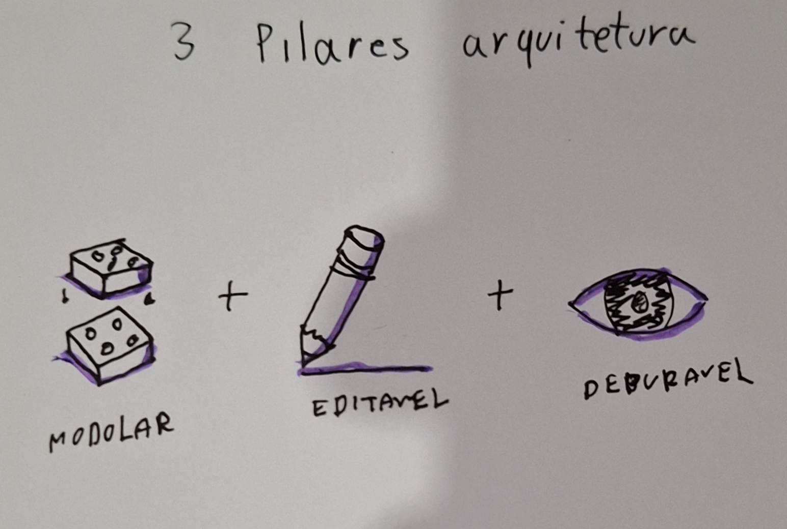
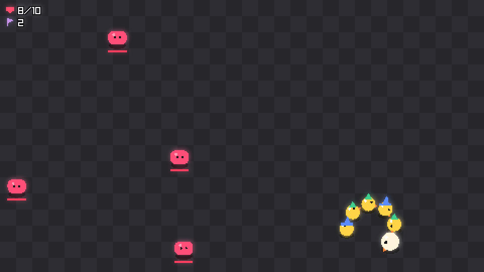
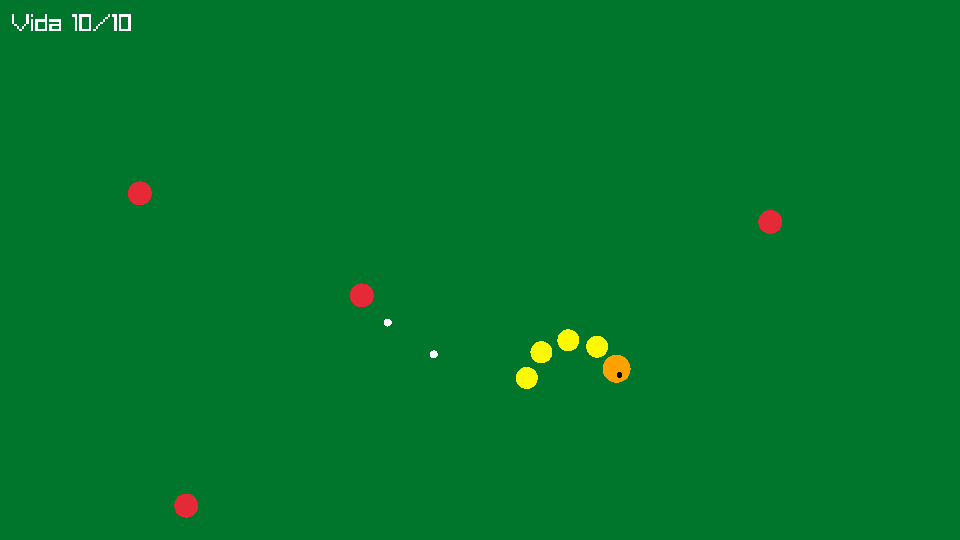
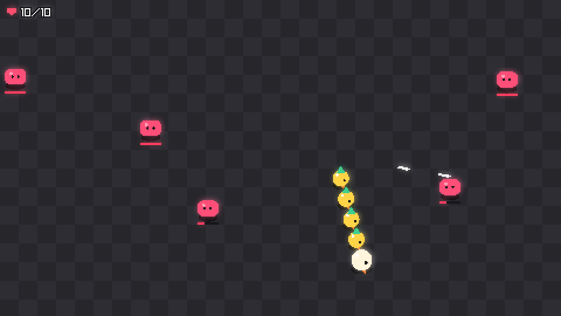
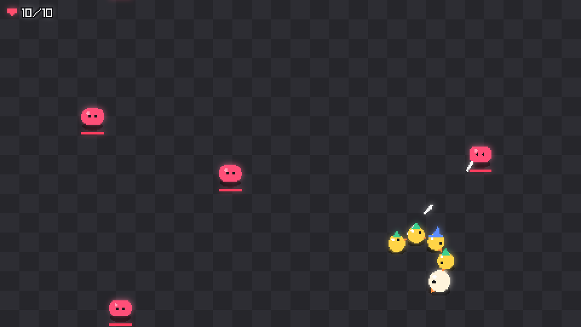
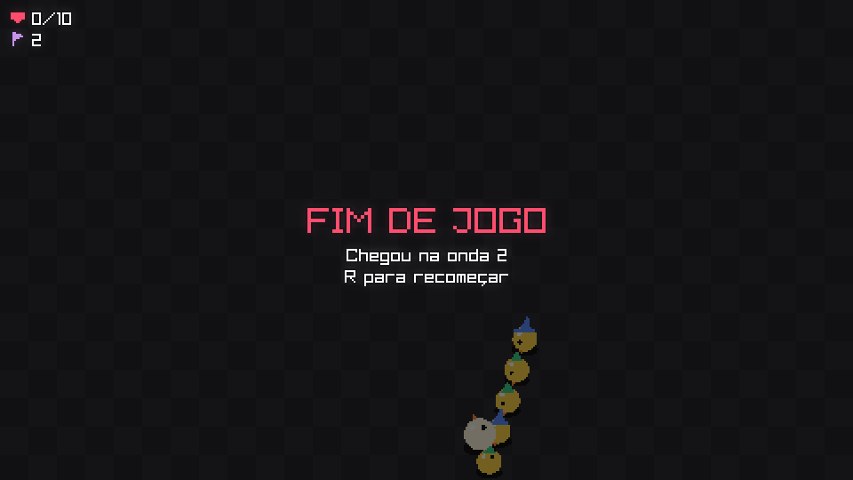
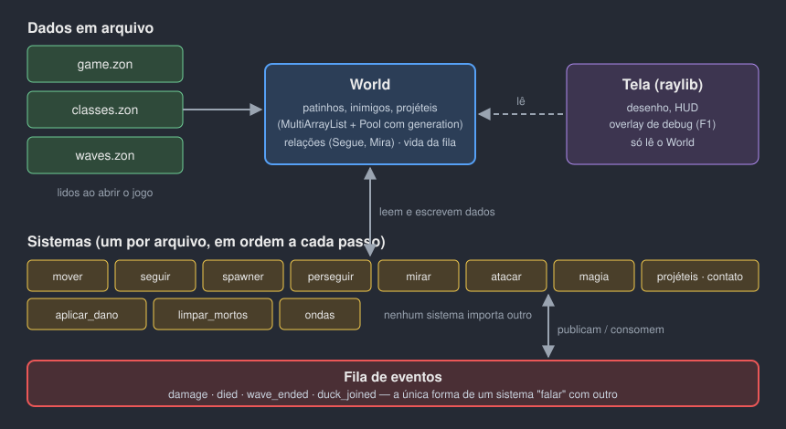
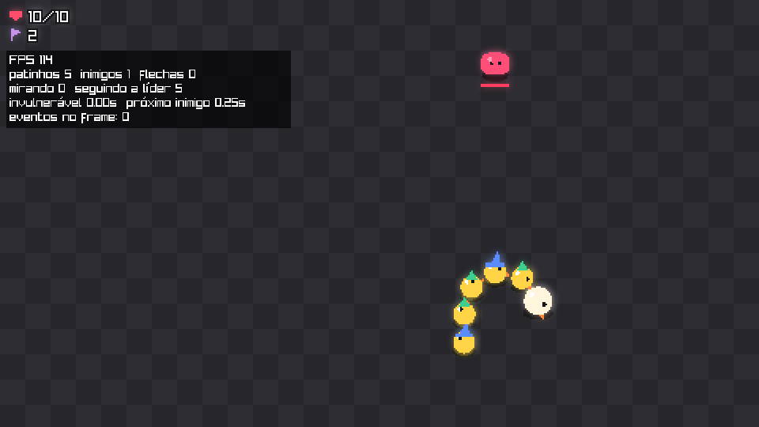

## Introdução

Há pouco mais de um ano, terminei a série **Explorando Arquiteturas** com um roguelite feito três vezes: [Spaghetti](https://solracjunio.github.io/2025/06/30/Explorando-Arquiteturas-Spaghetti.html), [ECS](https://solracjunio.github.io/2025/07/03/explorando-arquiteturas-ecs.html) e [SOAP](https://solracjunio.github.io/2025/07/20/explorando-arquiteturas-soap.html). A conclusão foi clara: **SOAP venceu em todos os aspectos**.

Só que, de lá para cá, duas coisas mudaram na forma como eu programo:

* Boa parte do código agora é escrita **com IA**, usando o **Claude Code**.
* A **Unity deixou de ser minha ferramenta principal**.

E aí veio a dúvida: **será que aquela conclusão ainda vale?**

O SOAP brilha justamente por causa do ScriptableObject e do Inspector da Unity. Sem a engine, o que sobra dele? E o ECS, que abandonei na parte 2 por ser trabalhoso demais de escrever... ainda é trabalhoso quando quem digita é a IA?

Para responder, fiz o que sempre faço: **um jogo novo para servir de laboratório**.

Repositório no [Github.](https://github.com/solracjunio/QuackAttack)

---

## Parte 1 – O Que Muda Quando Quem Digita é a IA

Antes, o custo principal era **escrever** código. Agora a IA escreve rápido, e o custo passa para outros lugares:

1. **A IA precisa ver o sistema inteiro em texto.** Ela lê arquivos, mas não vê o Inspector.
2. **Eu preciso conseguir revisar o que ela fez.** Código que eu não entendo vira dívida.
3. **Tem que dar para verificar com teste**, sem abrir o editor e sair clicando.
4. **Tudo tem que caber no contexto:** peças pequenas e locais funcionam melhor do que uma teia.

Com esses critérios, cada arquitetura muda de lugar no ranking:

| | **SOAP** | **ECS** | **OOP** |
|---|---|---|---|
| **Antes** | A melhor da série | Abandonada na parte 2 | O ponto de partida (e o espaguete) |
| **Com IA** | Perde muito: a fiação fica no editor, o ponto cego da IA | Ganha no formato: sistemas pequenos e fáceis de testar | É o que a IA mais conhece, mas também onde ela mais deixa crescer o God Object |

### ❌ Onde o SOAP sofre

As ligações do SOAP ficam em arquivos `.asset`, `.prefab` e `.unity` (YAML cheio de `guid` e `fileID`). A IA até consegue ler, mas editar é frágil e responder "quem escuta este evento?" é difícil. E a grande vantagem, "o designer edita sem o programador", pesa pouco num projeto solo.

### ⚠️ Onde o ECS engana

A IA reduz o custo de **escrever** ECS, não o de **entender**. Se eu não domino o que ela gerou, não consigo revisar.

Na série, usei o **Flecs** (pelo binding Flecs.NET), e depois usei um pouco o [**RelEcs**](https://github.com/Byteron/RelEcs) em outros protótipos. O RelEcs é leve, estável e já traz os relacionamentos que eu tanto gostava. Mesmo assim, não continuei com ele por um motivo simples: **o SOAP exigia muito menos código para chegar no mesmo lugar**. No ECS, cada coisa vira componente, sistema e query, e ajustar um valor ou inspecionar o jogo pede ferramenta própria. No SOAP, eu criava um asset, arrastava no Inspector e pronto.

Com a IA escrevendo, esse "exige mais código" pesa bem menos. Mas o código continua lá, e alguém precisa entender e revisar tudo.

---

## Parte 2 – O Essencial de Cada Arquitetura

Em vez de escolher uma das três, resolvi fazer uma pergunta diferente: **o que sobra de cada uma quando se tira a engine e o framework?**

### 🧾 Do SOAP

1. **Dados em arquivo, separados do código.** Mudar um número não exige mexer na lógica.
2. **Eventos como objetos.** Qualquer um publica, qualquer um escuta, sem que um conheça o outro.
3. **Variáveis observáveis.** A UI escuta a variável, não o `Player`.

**O que deixar:** a fiação pelo editor e a explosão de assets.

### 🧬 Do ECS

1. **Separar dados de lógica.** Componentes são dados; sistemas são funções.
2. **Composição em vez de herança.**
3. **Identidade por id, não por ponteiro**, com *generation* para não acertar um objeto que já foi destruído.
4. **Relacionamentos com curinga**, como `(Mira, inimigo)` e a consulta `(Mira, *)`. Foi a parte do Flecs que mais me impressionou.

**O que deixar:** archetypes, otimização de cache e o framework completo, a não ser que o jogo tenha milhares de entidades.

### ⚙️ Da OOP

1. **Encapsulamento:** a vida nunca fica negativa, e quem usa não precisa saber como.
2. **Uma responsabilidade por objeto**, o contrário do `Player` de 79 linhas da [versão Spaghetti](https://solracjunio.github.io/2025/06/30/Explorando-Arquiteturas-Spaghetti.html).
3. **Composição de objetos pequenos.**

**O que deixar:** herança profunda, God Objects e getters/setters para tudo.

### 🤝 Onde as três se encontram

Cada uma do seu jeito, as três combatem o mesmo inimigo: **o acoplamento**.

* **SOAP** desacopla pela **comunicação**: eventos e variáveis.
* **ECS** desacopla pela **estrutura**: dados separados da lógica.
* **OOP** desacopla pelo **contrato**: encapsulamento e interfaces.

Juntando tudo: **objetos pequenos e compostos, com dados vindos de arquivo, conversando por eventos, referenciados por id e com relacionamentos consultáveis.**

---

## Parte 3 – Os Três Pilares Como Métrica

Para não ficar só na opinião, precisava de uma régua. Peguei os **três pilares** da palestra do Ryan Hipple sobre SOAP, a mesma que inspirou o post do SOAP:



| Pilar | Pergunta | Meta no projeto |
|---|---|---|
| **Modular** | Dá para tirar, trocar ou testar uma parte sem mexer nas outras? | 0 imports entre sistemas; lógica testável sem janela; classe nova toca no máximo 2 arquivos |
| **Editável** | Dá para mudar o comportamento sem mexer no código? | 0 números de balanceamento no código; ondas vindas de dados |
| **Depurável** | Dá para ver o que está acontecendo e reproduzir um bug? | Overlay de debug; seed fixa; todo bug corrigido ganha teste |

O detalhe importante: **todas essas metas são medidas por ferramenta**, no CI, e não por "achismo".

---

## Parte 4 – O Laboratório: QuackAttack

**⏱ Tempo de desenvolvimento:** ~4h (trabalho da IA, com os meus prompts e revisões)  
**🛠 Stack:** Zig + raylib, programado com o Claude Code

O jogo: **uma pata guia uma fila de patinhos** que anda como uma cobra. Você só controla a direção da líder. Os patinhos atacam sozinhos, as ondas de inimigos perseguem a fila, e a cada onda vencida entra um patinho novo, de classe sorteada:

* **Arqueiro:** atira no inimigo mais próximo.
* **Mago:** causa dano em área em volta de si.



### A evolução, fase a fase

Como nos posts anteriores, registrei o jogo em cada etapa. Cada captura foi tirada do código como ele estava no commit daquela fase.

**Fase 0 – Setup:** a janela abrindo com raylib-zig. O ponto de partida.


**Fase 1 – Fila:** a líder vira e os patinhos seguem o caminho dela, como uma cobra.


**Fase 2 – Inimigos e combate:** os inimigos chegam pelas bordas e os arqueiros atiram. Tudo por eventos.



**Guia visual:** a mesma lógica com um visual novo: pixel grande, sombras e carinhas. Nenhum sistema precisou mudar, só o código de tela.



**Fase 3 – Dados e classes:** as classes passam a vir de arquivo: capuz verde do arqueiro e chapéu azul do mago.



**Fase 4 – Ondas e fim de jogo:** a cada onda vencida, um patinho novo entra no fim da fila. Quando a vida chega a 0, o mundo congela e a tela mostra a onda alcançada.



### Por que Zig?

Zig **não tem classes, herança nem interfaces prontas**. Isso me obrigou a usar só o essencial de cada arquitetura, sem muleta:

* **OOP:** sobram encapsulamento por módulo e funções pequenas.
* **ECS:** o `std.MultiArrayList` já guarda os dados separados por campo, que é o layout de um ECS.
* **Composição:** as *tagged unions* resolvem o "um patinho é a soma das partes dele".

### A estrutura



> Repare que não existe nenhuma seta entre os sistemas. Eles só leem e escrevem no `World` e se comunicam pela **fila de eventos**. É a mesma ideia do SOAP, de "orbitar em torno dos dados", só que agora escrita em código, onde a IA consegue enxergar.

---

## Parte 5 – O Essencial na Prática

### 📄 Dados em arquivo

As classes ficam em `data/classes.zon`. Mudar o alcance do arqueiro não exige recompilar, e uma classe nova que usa um ataque que já existe é só uma entrada a mais:

```zig
.{
    .name = "arqueiro",
    .look = .{ .hat = .hood, .accent = .green },
    .attack = .{ .projectile = .{
        .range = 230, .cooldown = 0.7, .damage = 1, .speed = 420, .radius = 4,
    } },
},
```

### 📣 Eventos como objetos

Os sistemas não se chamam. Eles só acrescentam eventos numa fila, que é processada uma vez por passo, sem callbacks:

```zig
pub const Event = union(enum) {
    damage: struct { target: Target, amount: u32 },
    died: struct { enemy: Handle },
    wave_ended: struct { wave: u32 },
    duck_joined: struct { duck: u32, class: u32 },
};
```

O bônus veio de graça: como o `switch` do Zig é exaustivo, **um tipo de evento novo sem texto no overlay de debug simplesmente não compila**. O pilar Depurável é garantido pelo compilador.

### 🔗 Relacionamentos com curinga

A parte do ECS que eu mais queria testar. Cada arqueiro mantém um `(Mira, inimigo)`. Quando um inimigo morre, uma única consulta desfaz todas as relações que apontavam para ele:

```zig
// Mira no inimigo mais próximo dentro do alcance
try w.relations.set(gpa, .mira, me, .{ .enemy = h });

// Quem morreu perde todas as relações que apontam para ele
w.relations.clearWhere(.mira, .{ .is = .{ .enemy = morto } });

// Todos que estão atacando alguém
var it = w.relations.query(.mira, .any);
```

O registro inteiro tem **cerca de 100 linhas**. Não precisei de um framework de ECS para ter a parte dele que mais me interessava.

### 🛡 Encapsulamento

O Zig não tem campos privados, então o encapsulamento é **por convenção**: a vida só muda pelas funções do módulo `health.zig`:

```zig
pub fn damage(self: *Health, amount: u32) void {
    self.current -|= amount; // subtração saturada: nunca fica negativa
}
```

### 🪛 Overlay de debug

Com **F1**, o jogo mostra FPS, entidades, quem está mirando, quem segue a líder e os eventos daquele frame. Junto com a **seed fixa**, qualquer partida pode ser reproduzida.



### ❓ E as variáveis observáveis?

Essa foi a surpresa. Deixei de propósito para **testar se fariam falta**: a UI lê o `World` direto, a cada frame.

**Não fizeram falta.** Com o estado inteiro num lugar só e a tela redesenhada todo frame, observar mudanças não traz nada. Na Unity, com objetos espalhados pela cena, elas fazem sentido. Aqui, não.

---

## Parte 6 – Os Resultados

### Os três pilares

| Pilar | Meta | Resultado |
|---|---|---|
| Modular | 0 imports entre sistemas | ✅ |
| Modular | Lógica testável sem janela | ✅ |
| Modular | Classe nova toca no máximo 2 arquivos | ⚠️ parcial |
| Editável | 0 números de balanceamento no código | ✅ |
| Editável | Ondas vindas de dados | ✅ |
| Depurável | Overlay de debug (F1) | ✅ |
| Depurável | Seed fixa | ✅ |
| Depurável | Todo bug corrigido ganha teste | ✅ |

**7 de 8 metas cumpridas.** A que ficou parcial é honesta: uma variação de classe (um "besteiro", com mais alcance e menos cadência) é **1 arquivo**. Mas o mago, que trouxe um ataque novo e um acessório novo, tocou **7 arquivos**. O pilar acerta no caso comum e erra no caso caro: **comportamento novo ainda pede código**.

### Comparando com a série

> ⚠️ As versões da série são em C# e Unity e seguiam um tutorial; o QuackAttack é outro jogo, em outra linguagem. A comparação vale pelas **tendências**, não pelos números exatos. As métricas foram medidas com o mesmo script nos quatro códigos.

| Métrica | Spaghetti | ECS | SOAP | QuackAttack |
|---|---|---|---|---|
| Tempo | 5h36 | 4h24 (abandonado) | 3h05 | ~4h (com testes e ferramentas) |
| Linhas de produção | 448 | 340 | 266 | 1.029 (lógica) |
| Testes | 0 | 0 | 0 | **124** |
| Complexidade máxima | 6 | 5 | 4 | 7 |
| Debug | Direto, mas acoplado | Sem Inspector | Intuitivo | Overlay + seed fixa |

> **Complexidade máxima:** quantos caminhos diferentes (cada `if`, laço ou ramo de `switch`) existem na função mais complicada do projeto. Até 10 é considerado simples.

O QuackAttack é maior porque **faz mais**: MVP completo, desenho todo em código e testes. A diferença real não está no tamanho, e sim no que veio junto:

* **Cobertura de 100%** da lógica.
* **Teste de mutação** com 161 mutantes mortos e nenhum sobrevivente.
* **Nenhum número de balanceamento** no código.

### 🧠 Carga mental

Esse foi o ponto que mais mudou. Na versão SOAP, a organização dependia de eu lembrar das regras. Aqui, **as regras ficaram no `CLAUDE.md` e no CI, não na minha cabeça**. Se a IA (ou eu) importar um sistema dentro de outro, o build reprova.

### O ECS completo faria falta?

Medi. Com **1.000 inimigos na tela**, o jogo ainda roda a **60 FPS**. E a simulação sozinha aguenta **50 mil inimigos em 0,12 ms por passo**.

O gargalo é o **desenho**, não a lógica: cada inimigo são umas 8 formas primitivas desenhadas uma a uma. Para ter mais inimigos na tela, o caminho seria usar sprites num atlas, **não trocar a arquitetura**.

---

## Análise Técnica

### ✅ Pontos Positivos

* **Tudo em texto:** a IA vê o sistema inteiro, e eu consigo revisar com `grep`.
* **Regras medidas por ferramenta**, não por disciplina.
* **Lógica testável sem abrir o jogo.**
* **Pegou o melhor de cada arquitetura** sem carregar o peso de nenhum framework.

### ❌ Pontos Negativos

* **Comportamento novo ainda toca muitos arquivos** (o caso do mago).
* **Encapsulamento por convenção**, já que o Zig não tem campos privados.
* **A IA escreveu API de outra versão do Zig 5 vezes.** Todas foram pegas pelo compilador, mas só porque a versão estava fixada e o `CLAUDE.md` mandava conferir a biblioteca padrão local.
* **O código de tela não tem teste.** O único bug que só apareceu rodando o jogo foi justamente lá.

---

## Conclusão: Os Três Modelos, Não Um

Um ano atrás, minha resposta seria "use SOAP". Hoje, ela mudou:

> **Não escolha uma arquitetura pura. Pegue o essencial das três e meça pelos três pilares.**

* Do **SOAP**: dados em arquivo e eventos desacoplados, **declarados em código**.
* Do **ECS**: dados separados de lógica, ids com generation e relacionamentos.
* Da **OOP**: encapsulamento, uma responsabilidade por objeto e composição.

E, programando com IA, um quarto ingrediente virou obrigatório: **regras escritas e verificadas automaticamente**. A IA escreve rápido, mas é o compilador, os testes e o CI que garantem que ela não vai trazer o espaguete de volta.

O SOAP não perdeu. Ele só deixou de ser uma ferramenta e virou **um conjunto de ideias**. E isso, no fim, é o que eu levo para qualquer linguagem.

---

## Fim do Laboratório

O QuackAttack para aqui. Ele nunca foi pensado para virar um jogo completo: era um laboratório para testar o essencial das três arquiteturas, e **esse propósito foi cumprido**. O que fica são as ideias e as regras, prontas para o próximo projeto.

**Obrigado por acompanhar essa jornada!**  
Se você também está programando com IA, me conta nos comentários: sua arquitetura mudou?
